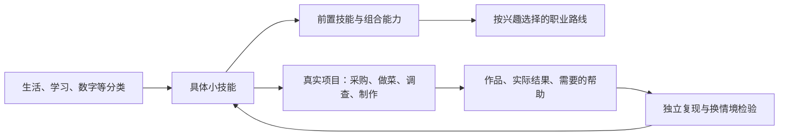

# 成长森林：路线设计与阶段目标

2026-10-20。首版范围：72 项技能、11 类、11 条路线、8 个项目；以可操作、可检验为内容门槛，不追求技能数量。

## 产品中的关系

分类用于寻找；前置关系用于安排学习；项目复用同一个技能编号，不复制一份独立熟练度。大技能可以继续拆小，粒度随孩子已有能力变化。

## 五条基础路线

| 路线 | 可见的练习与成果 |
|---|---|
| 生活自主 | 列清单、比较每 100 克价格、按清单采购、系袋口、备料、做熟一道菜 → 为家人准备一顿午餐 |
| 会学习 | 拆出能开始的动作、从示例做变式、合上资料回答问题、延后复现、追溯来源、向人讲清 → 做一份观察作品 |
| 数字与 AI | 文件整理与验证备份、账号恢复、图片分享同意、表格核账、给 AI 清楚任务、逐条查证、复用过程 |
| 日常判断 | 读懂说明、写可照做的说明、按单位测量、估算后核算、预算取舍、核对找零、比较实际资源用量 |
| 协作与照顾自己 | 观察活动与状态、描述情绪与求助、问清需要、发清楚请求、任务分工、检查结果、具体复盘与展示 |

这些方向来自对现实任务的分解。OECD 和 UNESCO 提供方向，不能据此认定本清单囊括了未来全部必需能力。基础路线不等同于学校学科大纲；语言、数学及其他学科会随着真实项目继续拆分扩充。

## 六条职业探索路线

| 职业方向 | 具体动作链 | 完整练习项目 |
|---|---|---|
| 软件与 AI 应用开发 | HTML 表单 → CSS 小屏排版 → 输入事件 → 本地保存 → 用例检查 → 带说明发布 | 可保存的家庭采购清单网页 |
| 数据分析 | 写清问题 → 整理缺失与重复 → 查询汇总 → 选图 → 抽样核对 → 写可追溯结论 | 一份家庭采购记录分析 |
| 产品与体验设计 | 问真实需求 → 画操作流程 → 纸面原型 → 看人实际试用 → 检查可读性 → 交付说明 | 一个借书或阅读工具原型 |
| 科学与工程实践 | 提可测问题 → 测量记录 → 制作样件 → 控制变量对比 → 按记录复现 → 修改验证 | 改进一架纸直升机 |
| 教学与知识传播 | 写学习结果 → 演示动作 → 设计提取练习 → 针对错误反馈 → 换情境检验 → 完成一次小教学 | 教会别人系袋口并验证 |
| 经营与运营 | 问实际需要 → 算材料成本 → 写清提供什么 → 盘点数量 → 小范围试做 → 看结果改进 | 用模拟代币进行一次小集市 |

职业范围参考 O*NET 相应职业任务，结合 WEF 的趋势信号。入口依据已有能力与兴趣，不按年龄锁定未来职业。医疗、法律等需要专业资格的方向尚未编写完整路线，不能用这六条代表所有职业。

## 一张技能卡的必填内容

1. 一个明确动作和结果，例如“比较两件商品的每 100 克价格”。
2. 前置技能、工具、材料及必要的成人支持。
3. 按顺序的具体操作，能看出从哪里开始。
4. 可观察的完成条件和常见卡点，允许失败、求助和重试。
5. 示范后尝试、独立复现、延后复习、换材料或场景再做。
6. 可调用它的实际项目，以及作品或结果记录。
7. 来源、核对日期、来源用途和内容版本；区分研究证据、官方操作说明及社区经验。

例如“系袋口”：放稳物品并留出袋口 → 两提手交叉、绕过穿出 → 轻拉检查 → 解开重系 → 采购后换合适袋子再试。检查提起后不掉物、能解开重用；只做了一次不自动标为熟练。

## 掌握证据的设计标准

建议分别记录“看过示范”“在帮助下做成”“独立做成”“延后还能做”“换情境还能做”。这是观察维度，不能仅由累计次数推算。不同技能不必使用同样次数、天数或耗时阈值。

每次项目记录：调用的技能、实际结果、由谁完成、用了什么帮助、困难和下一步。当前实现已有技能引用、结果与复盘自述；独立的多维能力测评界面仍需下一阶段实现。

## 阶段目标与验收

| 阶段 | 目标 | 验收方式 |
|---|---|---|
| 当前交付 | 三端记录可同步；所有首版技能有具体步骤和来源；项目复用已有技能 | 自动浏览器测试、事务与冲突测试、内容引用与前置环检查 |
| 下一轮内容试用 | 先选 3 个真实家庭项目，跟随孩子实际操作修正卡点 | 每个项目观察至少 3 次实际使用；记录卡住的步骤、成人帮助和修改前后差异 |
| 掌握证据 | 分开保存独立完成、延后保持和换情境使用的事实 | 同一技能在两个实际任务中可追溯；不能凭点击次数认定掌握 |
| 扩充职业路线 | 根据兴趣和实际任务补充，不一次铺满职业百科 | 每新增一条路线有真实项目、可执行技能卡、权威任务来源和实践反馈 |
| 持续内容维护 | 来源失效、工具更新或试用暴露问题时修订 | 保留版本和修订原因，已有孩子记录不因模板更新被覆盖 |

上述家庭试用数量是下一轮实施目标，不是已经获得的教学效果数据。商业目标应在孩子持续使用、能说清学会什么和家庭真实付费意愿出现后再定量。

## 从互联网取材的方法

先查原始研究、职业任务和官方操作说明，再用 GitHub 开源实践补充案例。只引用来源链接和必要事实；练习卡自行编写，不整套搬运课程、图谱、评测或图片。来源支持某种方法不代表该机构认证了产品，也不等于该练习已经证明对所有孩子最优。

主要依据：[OECD Learning Compass](https://www.oecd.org/en/data/tools/oecd-learning-compass-2030.html)、[UNESCO AI 学生能力框架](https://www.unesco.org/en/articles/ai-competency-framework-students)、[O*NET 职业任务](https://www.onetonline.org/)、[IES 学习实践指南](https://ies.ed.gov/ncee/wwc/PracticeGuide/1)、[Microsoft AI 入门课程](https://github.com/microsoft/generative-ai-for-beginners)、[HowToCook](https://github.com/Anduin2017/HowToCook)。每张技能卡另附相应领域来源。
