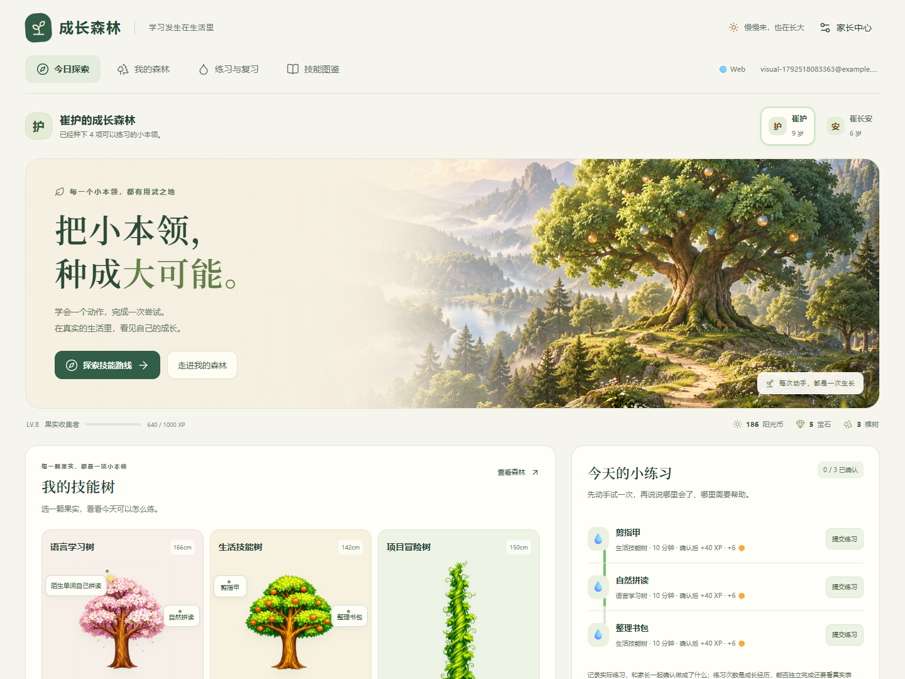

# 成长森林 V24

在 /forest/ 提供统一的成长森林界面：原创森林主视觉、中文排版与本地图标，具体技能路线、练习和项目结果共用已有家庭记录。

[手机界面](previews/v24-phone-home.png) · [技能操作卡](previews/v24-desktop-skill-guide.png) · [离线技能树总览](技能树总览.html) · [视觉规范与资产](design/视觉规范与资产.md)

保留 72 项技能、11 条路线、8 个项目，以及自动同步、离线补传、冲突、账号隔离和事件去重。页面升级为 V24，数据协议兼容 23；不重置孩子的记录。

运行相关检查：npm run test:forest。技能内容入口为 scripts/build-forest-library.mjs；离线图谱入口为 scripts/build-forest-overview.mjs。

完整开发工程、原生工程、脚本、测试与证据保存在 deliveries/ 下版本化交付中。手机和平板是浏览器模拟，实机、原生安装包、生产账号和真实儿童体验尚未验收。生产网站尚未发布。
