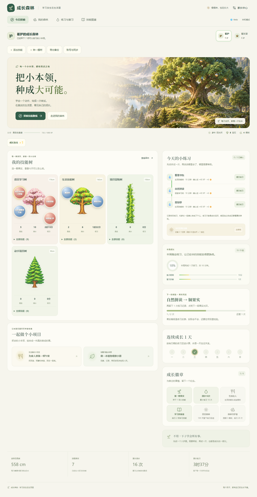

# 成长森林 V25：完整应用与原有功能恢复

完整应用位于 /forest/。离线技能树总览是只读课程资料，不能替代应用的练习、项目或账号记录。

V24 删掉的奖励、连续成长、徽章与连击展示已恢复；蓝／红技能果实及金银铜光环恢复。首页在插画前提供添加技能、种树、导出备份和账号同步入口。所有宽度显示所有树，每棵树可展开全部技能。

[手机页面](previews/v25-390-home.png) · [功能核对](功能恢复核对.md) · [完整开发交付](../../deliveries/forest-v25-20261021/README.md) · [只读课程资料](技能树总览.html)

保留原版状态与稳定技能 ID、72 技能、11 路线、8 项目，以及协议 23 的同步、离线补传、冲突保留与账号隔离。未更改后端或数据库结构。

旧备份导入、第五项技能练习、导出与刷新保留，1440／1024／820／390／360 像素，以及三端同步均已回归。手机平板是浏览器模拟，生产账号同步和实机尚未验收。生产网站未发布。
